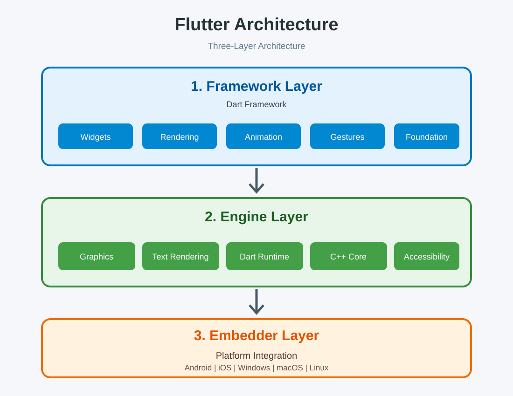

# RZXXY Flutter Research

## Project Overview

This project studies Flutter,
Google's open-source UI development SDK.

## Flutter Architecture Diagram

## Research Topics

1. Flutter Introduction
2. Flutter Architecture
3. Dart Programming Language
4. Flutter Features
5. Software License
6. iSH Compatibility
7. Flutter vs React Native

## Research Environment

- Device: iPhone
- Environment: iSH
- OS: Alpine Linux
- Architecture: i686

## Project Status

Research Started.
